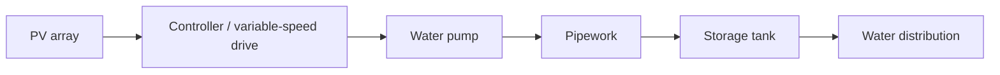

# System flow — preliminary

The diagram below represents the general energy and water pathway. It is conceptual: the actual equipment and wiring must be confirmed with the operator.

## Notes
- The PV array supplies electrical energy.
- The controller or variable-speed drive adapts and controls the supply to the pump.
- The pump moves water through the pipework to the tank.
- The tank provides storage before distribution.

The presence of batteries, a grid connection, a generator, or a particular controller topology has not been established. These should not be assumed without site documentation.
